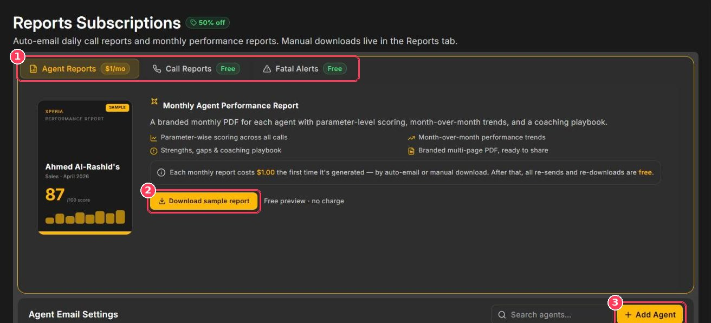
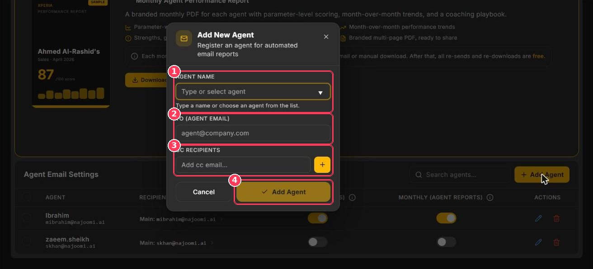

**Mail Config** opens **Reports Subscriptions**, where you choose which reports Xperia emails automatically and who receives them. Manual downloads remain available in [Agent Reports](/Pages/agentReports) and [Call Scoring](/Pages/callScoring).

**To open it:** in the sidebar, under **Configuration**, click **Mail Config**.

<Frame caption="Reports Subscriptions page">
  
</Frame>

| # | Element | Description |
| :-: | --- | --- |
| 1 | **Report tabs** | **Agent Reports** (\$1/mo), **Call Reports** (Free), and **Fatal Alerts** (Free). |
| 2 | **Download sample report** | Free preview of the selected report. |
| 3 | **Add Agent** | Register an agent to receive reports by email. |

## Report types

<Tabs>
  <Tab title="Agent Reports">
    **Monthly Agent Performance Report** — a branded multi-page PDF for each agent, including:

    - Parameter-wise scoring across all calls
    - Month-over-month performance trends
    - Strengths, gaps, and a coaching playbook

    **Cost:** \$1.00 per report the first time it is generated (by email or manual download). Re-sends and re-downloads are free.
  </Tab>
  <Tab title="Call Reports">
    **Daily Call Scoring Report** — a per-call PDF emailed automatically every morning, including:

    - The full 10-category QA scorecard
    - AI summary, suggestions, and reasoning

    **Cost:** free.
  </Tab>
  <Tab title="Fatal Alerts">
    **Fatal Incident Alerts** email the call's report and summary **the moment** a call is scored as a fatal incident.

    1. Turn on the **Fatal Incident Alerts** toggle.
    2. Under **Recipients (To)**, type an email address and click **\+**. Repeat for additional recipients.
    3. Optionally add **CC Recipients** the same way.
    4. Click **Save changes**.

    Use the pencil next to an address to edit it, or **×** to remove it.

    **Cost:** free.
  </Tab>
</Tabs>

## Agent email settings

The **Agent Email Settings** table at the bottom of the page controls which agents receive reports and where they're sent.

| Column | Description |
| --- | --- |
| **Agent** | The agent the reports are about. |
| **Recipients** | Addresses that receive the reports; the primary address is labelled _Main_. |
| **Daily (Call Reports)** | Toggle on to email the agent's call reports every morning. |
| **Monthly (Agent Reports)** | Toggle on to email the monthly performance report. |
| **Actions** | Edit (pencil) or remove (bin). |

### Add an agent

<Frame caption="Add New Agent dialog">
  
</Frame>

| # | Field | Description |
| :-: | --- | --- |
| 1 | **Agent Name** | Type a name or choose an agent from the list. |
| 2 | **To (Agent Email)** | The main recipient, usually the agent. |
| 3 | **CC Recipients** | Additional recipients such as a team lead or QA manager. Type an address and click **\+**. |
| 4 | **Add Agent** | Saves the agent. |

After adding the agent, use the **Daily** and **Monthly** toggles in the table to choose which reports they receive.

<Tip>
  Use the **Search agents** box above the table to find an agent quickly.
</Tip>
