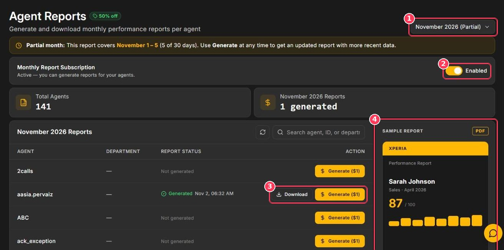

**Reports** creates a monthly **Agent Performance Report** for any agent — a branded, multi-page PDF with parameter-level scoring, month-over-month trends, strengths and gaps, and a coaching playbook.

**To open it:** in the sidebar, under **Operations**, click **Reports**.

<Frame caption="Agent Reports page">
  
</Frame>

| # | Element | Description |
| :-: | --- | --- |
| 1 | **Month selector** | Choose the reporting month. The current month is marked _(Partial)_. |
| 2 | **Monthly Report Subscription** | Must be **Enabled** before you can generate reports. |
| 3 | **Download · Generate (\$1)** | Generate a report for an agent, or download one that's already generated. |
| 4 | **Sample Report** | Preview the report layout. Click **Download sample** for a free PDF. |

The page also shows **Total Agents**, the number of reports **generated** for the selected month, and a searchable table of every agent with their department and **Report Status** (_Not generated_ or _Generated_ with a date and time).

## Generate a report

<Steps>
  <Step title="Choose the month">
    Use the month selector in the top-right corner.
  </Step>
  <Step title="Find the agent">
    Search by agent name, ID, or department, or page through the table.
  </Step>
  <Step title="Generate">
    Click **Generate (\$1)** in the agent's row. The status changes to **Generated**.
  </Step>
  <Step title="Download">
    Click **Download** to save the PDF.
  </Step>
</Steps>

<Info>
  **Partial month:** for the current month, a banner shows which days are included (for example _November 1 – 5_). Click **Generate** again later to get an updated report.
</Info>

## Pricing

| Action | Cost |
| --- | --- |
| Generate a report for an agent and month | **\$1.00** |
| Download a report you already generated | **Free** |
| Regenerate the current month with newer data | **\$1.00** each time |

## What's inside the report

<CardGroup cols={2}>
  <Card title="Overall score" icon="gauge">
    The agent's average score for the month.
  </Card>

  <Card title="Parameter-wise scoring" icon="list-check">
    Performance on every parameter across all calls.
  </Card>

  <Card title="Month-over-month trends" icon="chart-line">
    How the agent is improving over time.
  </Card>

  <Card title="Coaching playbook" icon="graduation-cap">
    Strengths, gaps, and recommended next steps.
  </Card>
</CardGroup>

<Tip>
  Prefer to receive these automatically? Add the agent under **Agent Email Settings** in [Reports & Alerts](/Pages/Fatal_Alerts) and turn on **Monthly (Agent Reports)**.
</Tip>
