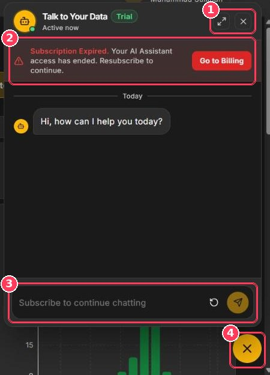

The **AI Assistant** — _Talk to Your Data_ — is a chat bot built into Xperia. Instead of building filters and reading charts, you can simply ask questions about your calls, agents, and scores in plain language.

**To open it:** click the **chat bubble** in the bottom-right corner of any page.

<Frame caption="Talk to Your Data assistant">
  
</Frame>

| # | Element | Description |
| :-: | --- | --- |
| 1 | **Expand · Close** | Expand the panel to a larger view, or close it. |
| 2 | **Subscription banner** | Appears only when your AI Assistant subscription has expired. Click **Go to Billing** to renew. |
| 3 | **Message box** | Type your question and click **Send**. The circular-arrow button starts a new conversation. |
| 4 | **Chat bubble** | Opens and closes the assistant from any page. |

## Ask a question

<Steps>
  <Step title="Open the assistant">
    Click the chat bubble in the bottom-right corner. The assistant greets you with _Hi, how can I help you today?_
  </Step>
  <Step title="Type your question">
    Ask in plain language — see the examples below.
  </Step>
  <Step title="Send">
    Click the send button or press **Enter**.
  </Step>
  <Step title="Follow up">
    Ask follow-up questions to drill deeper. Click the circular-arrow button to start fresh.
  </Step>
</Steps>

## Example questions

<CardGroup cols={2}>
  <Card title="Performance" icon="chart-line">
    - What was our average score last week?
    - Which agents scored below 60 this month?
  </Card>

  <Card title="Quality issues" icon="triangle-exclamation">
    - How many fatal incidents did we have yesterday?
    - Which parameter loses the most points?
  </Card>

  <Card title="Agents" icon="user">
    - How is Sarah performing compared to last month?
    - Who are our top five agents?
  </Card>

  <Card title="Trends" icon="arrow-trend-up">
    - Is churn risk increasing?
    - Which work codes are most common?
  </Card>
</CardGroup>

<Tip>
  Be specific about the **time period**, **department**, or **agent** you mean — for example, _"Average score for the Inbound department in October"_ gets a sharper answer than _"How are we doing?"_.
</Tip>

## Subscription

The AI Assistant is a paid add-on billed monthly. If the subscription has expired, the panel shows **Subscription Expired** and the message box reads _Subscribe to continue chatting_. Renew it from [Billing & Subscription](/Pages/billing).

<Note>
  You can also open the assistant from **Getting Started → What's New → AI Assistant → Try now**.
</Note>
