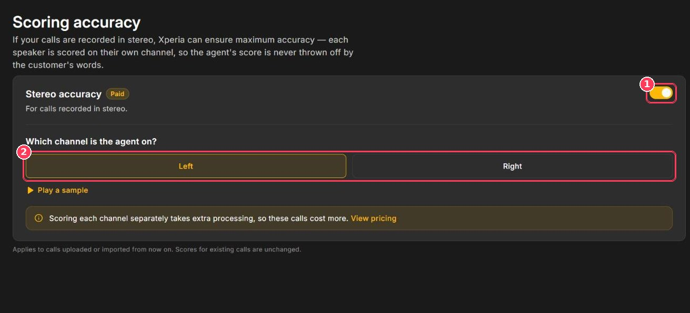

Many call systems record in **stereo** — the agent on one channel and the customer on the other. When Xperia knows which channel belongs to the agent, it scores each speaker separately, so the agent's score is never affected by something the customer said.

**To open it:** in the sidebar, under **Configuration**, click **Audio Config**.

<Frame caption="Scoring accuracy page">
  
</Frame>

| # | Element | Description |
| :-: | --- | --- |
| 1 | **Stereo accuracy toggle** | Turns per-channel scoring on or off. |
| 2 | **Which channel is the agent on?** | Choose **Left** or **Right**. Click **Play a sample** to compare. |

## Turn on stereo accuracy

<Steps>

  <Step title="Confirm your recordings are stereo">

    Ask your telephony provider, or open a recording in any audio editor — stereo files show two separate waveforms.

  </Step>

  <Step title="Turn on Stereo accuracy">

    Switch the toggle on (callout 1).

  </Step>

  <Step title="Select the agent's channel">

    Choose **Left** or **Right** (callout 2).

  </Step>

</Steps>

Your setting is shown on the [Upload Calls](/Pages/callUpload) page (for example _Stereo on — agent on the left channel_), with a **Change** link back to this page.

## Good to know

<CardGroup cols={2}>
  <Card title="Paid feature" icon="dollar-sign">
    Scoring each channel separately takes extra processing, so stereo calls cost more. Click **View pricing** on the page for current rates.
  </Card>

  <Card title="Applies going forward" icon="clock-rotate-left">
    The setting applies to calls uploaded or imported from now on. Existing scores are unchanged.
  </Card>
</CardGroup>

<Warning>
  If the wrong channel is selected, the agent will be scored on the customer's words. If scores look unusual after enabling stereo, check the channel first.
</Warning>

<Note>
  Mono recordings (a single channel) don't need this setting — leave it off.
</Note>
