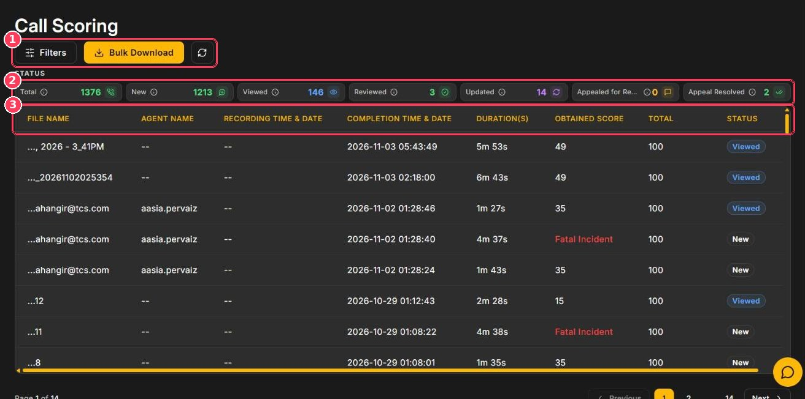
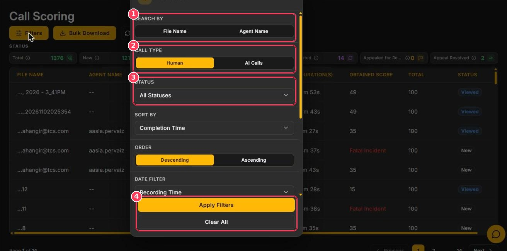
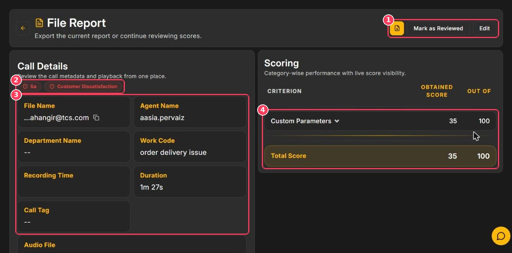
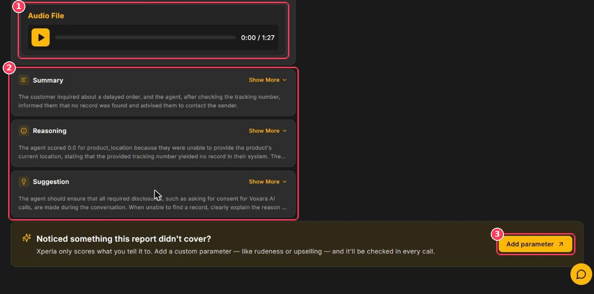
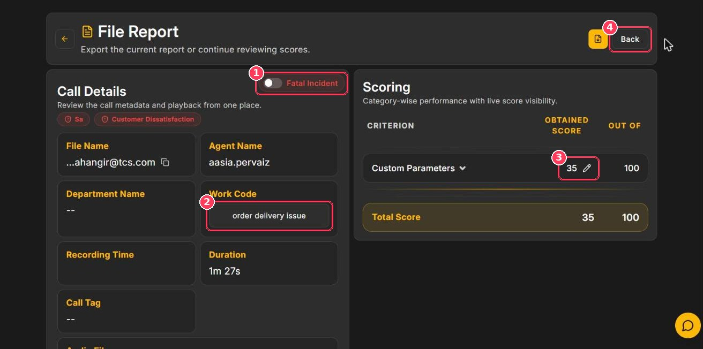
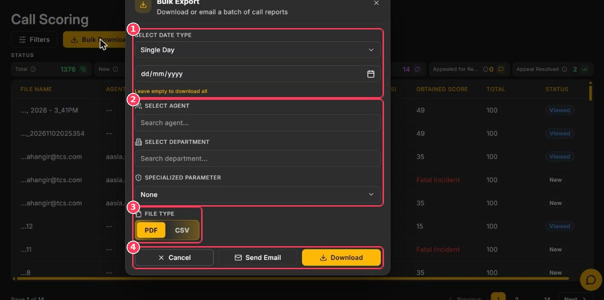

**Call Scoring** lists every call Xperia has processed. From here you can search and filter calls, open a call's full QA report, review or correct its score, respond to appeals, and download or email reports in bulk.

**To open it:** in the sidebar, under **Operations**, click **Call Scoring**.

## The Call Scoring page

<Frame caption="Call Scoring page">
  
</Frame>

| # | Element | Description |
| :-: | --- | --- |
| 1 | **Filters · Bulk Download · Refresh** | Filter the list, export reports in bulk, or reload newly scored calls. |
| 2 | **Status counters** | How many calls are in each review state. |
| 3 | **Call list** | One row per call. Click a row to open its report. |

### Status counters

| Status | Meaning |
| --- | --- |
| **Total** | All calls in the current view. |
| **New** | Scored, but the report has not been opened yet. |
| **Viewed** | The report has been opened. |
| **Reviewed** | A reviewer clicked **Mark as Reviewed**. |
| **Updated** | A reviewer edited the score or details after scoring. |
| **Appealed for Review** | The agent has appealed the score. |
| **Appeal Resolved** | An admin has responded to the appeal. |

### Call list columns

| Column | Description |
| --- | --- |
| **File Name** | Name of the recording (masked if [Hide File Name Display](/Pages/workspaceSettings#security) is on). |
| **Agent Name** | Agent assigned to the call, or "--" if none. |
| **Recording Time & Date** | When the call took place. |
| **Completion Time & Date** | When Xperia finished scoring it. |
| **Duration(s)** | Length of the call. |
| **Obtained Score** | Points earned. Shows **Fatal Incident** in red when a fatal condition was detected. |
| **Total** | Maximum points available. |
| **Status** | Review status, or **Error while processing!** if scoring failed. |

## Filter and search calls

Click **Filters** to open the **Filter By** panel. Choose your options, then click **Apply Filters**. **Clear All** resets the panel.

<Frame caption="Filter By panel">
  
</Frame>

| # | Option | Choices |
| :-: | --- | --- |
| 1 | **Search By** | File Name or Agent Name |
| 2 | **Call Type** | Human or AI Calls |
| 3 | **Status** | All Statuses, or a single status |
| 4 | **Apply Filters / Clear All** | Apply your choices, or reset them |

Scroll down in the panel for more options:

| Option | Choices |
| --- | --- |
| **Sort By** and **Order** | For example Completion Time, Descending or Ascending |
| **Date Filter** | Choose the date field (for example Recording Time), then **None**, **Single** date, or a **Range** |
| **Call Flag** | None, Fatal Call, or Dead Call |
| **Specialized Parameter** | Only calls flagged by a specific tracker |
| **Appealed for Review** | Only calls an agent has appealed |
| **Appeal Resolved** | Only appeals an admin has responded to |

<Tip>
**Build a coaching list in seconds:** set **Call Flag → Fatal Call**, choose a date range, and sort by Completion Time.
</Tip>

## Read a call report

Click any call to open its **File Report**.

<Frame caption="File Report — header, call details, and scoring">
  
</Frame>

| # | Element | Description |
| :-: | --- | --- |
| 1 | **Report actions** | **Export** the report as PDF (yellow icon), **Mark as Reviewed**, or **Edit** the scores. |
| 2 | **Flags** | Trackers the call matched, for example _Customer Dissatisfaction_. |
| 3 | **Call Details** | File name (with copy button), agent, department, work code, recording time, duration, and call tag. |
| 4 | **Scoring** | Obtained score and maximum score for each category. Click a category to expand its parameters. **Total Score** is shown at the bottom. |

Scroll down for the audio and the AI insights:

<Frame caption="File Report — audio and AI insights">
  
</Frame>

| # | Element | Description |
| :-: | --- | --- |
| 1 | **Audio File** | Play the recording without leaving the report. |
| 2 | **Summary · Reasoning · Suggestion** | What happened on the call, why each parameter scored as it did, and how the agent can improve. Click **Show More** to expand. |
| 3 | **Add parameter** | Create a custom parameter for something this report didn't check. It will be evaluated on every future call. |

## Edit a score

Reviewers can correct the AI when needed.

<Frame caption="File Report in edit mode">
  
</Frame>

| # | Element | Description |
| :-: | --- | --- |
| 1 | **Fatal Incident toggle** | Turn on to void the call (score zero), or off to restore a call flagged by mistake. |
| 2 | **Work Code** | Select the correct work code if the AI chose the wrong one. |
| 3 | **Score pencil** | Click to change the obtained score for a category or parameter. |
| 4 | **Back** | Leave edit mode. |

<Steps>
  <Step title="Open the report and click Edit">
    The report switches to edit mode.
  </Step>
  <Step title="Make your corrections">
    Change scores, the work code, or the fatal incident status.
  </Step>
  <Step title="Leave edit mode">
    Click **Back**. The call's status changes to **Updated**.
  </Step>
  <Step title="Mark as reviewed">
    Click **Mark as Reviewed** so your team knows the call has been checked.
  </Step>
</Steps>

## Handle score appeals

When an agent disagrees with a score, they can appeal it. Appealed calls are counted under **Appealed for Review**.

<Steps>
  <Step title="Find appealed calls">
    Click **Filters**, turn on **Appealed for Review**, and click **Apply Filters**.
  </Step>
  <Step title="Open the call">
    Review the agent's appeal from the report.
  </Step>
  <Step title="Respond">
    Respond to the appeal and correct the score if needed. The call moves to **Appeal Resolved**.
  </Step>
</Steps>

## Download or email reports in bulk

Click **Bulk Download** to export many reports at once.

<Frame caption="Bulk Export dialog">
  
</Frame>

| # | Element | Description |
| :-: | --- | --- |
| 1 | **Date** | Choose **Single Day** or a range, then pick the date(s). Leave empty to export everything. |
| 2 | **Agent · Department · Specialized Parameter** | Optional filters to narrow the export. |
| 3 | **File Type** | **PDF** for full reports, **CSV** for a spreadsheet of scores. |
| 4 | **Cancel · Send Email · Download** | Close the dialog, email the reports, or download the file. |
