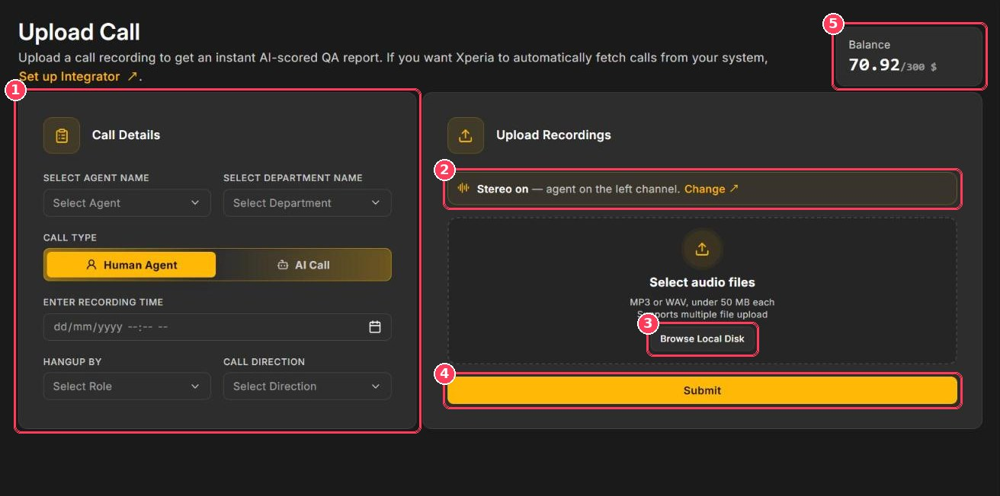

Use **Call Upload** to send one or more recordings to Xperia for scoring. To have calls arrive automatically from your phone system instead, set up the [Integrator](/Pages/integrations).

**To open it:** in the sidebar, under **Operations**, click **Call Upload**.

<Frame caption="Upload Call page">
  
</Frame>

| # | Element | Description |
| :-: | --- | --- |
| 1 | **Call Details** | Information about the call: agent, department, call type, recording time, who hung up, and call direction. |
| 2 | **Stereo banner** | Shows your stereo setting (for example _Stereo on — agent on the left channel_). Click **Change** to edit it in [Audio Configuration](/Pages/audioConfig). |
| 3 | **Browse Local Disk** | Selects one or more recordings from your computer. |
| 4 | **Submit** | Sends the recordings for scoring. |
| 5 | **Balance** | Your remaining account balance. Scoring is charged against it. |

## Supported files

<CardGroup cols={3}>
  <Card title="Formats" icon="file-audio">
    MP3 or WAV
  </Card>

  <Card title="Size" icon="weight-scale">
    Under 50 MB per file
  </Card>

  <Card title="Batch" icon="layer-group">
    Multiple files per upload
  </Card>
</CardGroup>

## Upload a call

<Steps>
  <Step title="Select the agent">
    In **Select Agent Name**, choose the agent who handled the call. Results appear under this name on the Dashboard and in Agent Reports.
  </Step>
  <Step title="Select the department">
    In **Select Department Name**, choose the department. Its parameter set and weightage are used to score the call.
  </Step>
  <Step title="Choose the call type">
    Select **Human Agent** for a call handled by a person or **AI Call** for a call handled by an AI voice agent.
  </Step>
  <Step title="Enter the recording time">
    Pick the date and time the call actually took place.
  </Step>
  <Step title="Set Hangup By and Call Direction">
    | Field | Options |
    | --- | --- |
    | **Hangup By** | Default, Agent, Customer |
    | **Call Direction** | Default, Inbound, Outbound |
  </Step>
  <Step title="Confirm the stereo setting">
    Check the stereo banner (callout 2). If agent and customer are on the wrong channels, click **Change**.
  </Step>
  <Step title="Add the recordings">
    Click **Browse Local Disk** and select one or more MP3/WAV files.
  </Step>
  <Step title="Submit">
    Click **Submit**. Scored calls appear in [Call Scoring](/Pages/callScoring) with the status **New**.
  </Step>
</Steps>

<Tip>
  Always set the agent and department. Calls without them are still scored, but show "--" for the agent and are harder to filter and report on.
</Tip>

## Best practices for accurate scores

- **Upload the original recording.** Re-encoded or heavily compressed audio reduces transcription accuracy.
- **Use stereo when available.** Scoring each speaker on their own channel is the most accurate option.
- **Pick the correct department.** Different departments can have different parameters and weightage.
- **Enter the real recording time.** Reports and trends are based on it.

## Troubleshooting

<AccordionGroup>
  <Accordion title="The file won't upload">
    Make sure it is an MP3 or WAV file under 50 MB. Convert other formats (M4A, OGG, AAC) first.
  </Accordion>

  <Accordion title="The call shows 'Error while processing!'">
    The recording could not be scored — usually because the audio is corrupt or silent. Re-upload the original file. If the error repeats, contact support with the file name.
  </Accordion>

  <Accordion title="The agent's score looks wrong">
    Check the stereo channel. If the agent and customer channels are swapped, the agent is scored on the customer's words.
  </Accordion>

  <Accordion title="Submit doesn't work">
    Check your balance (callout 5). If it is low, top up on the [Billing](/Pages/billing) page.
  </Accordion>
</AccordionGroup>
