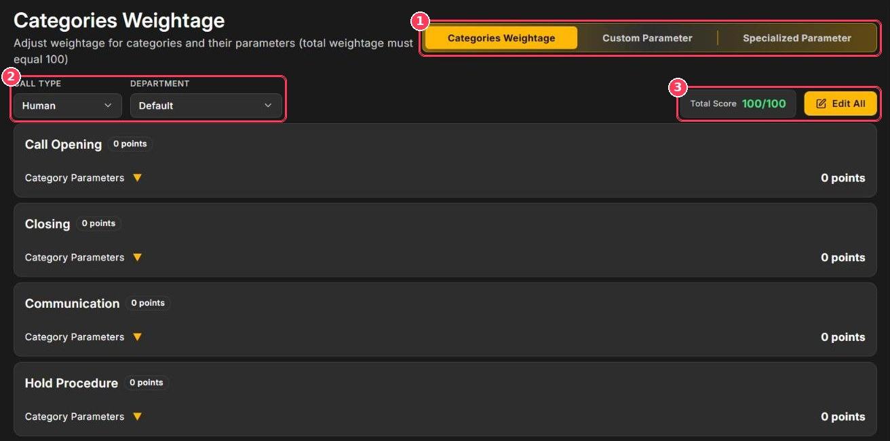
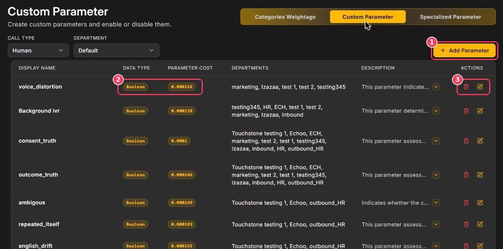
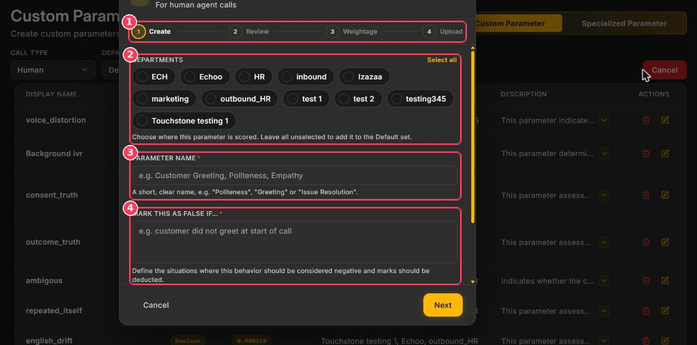
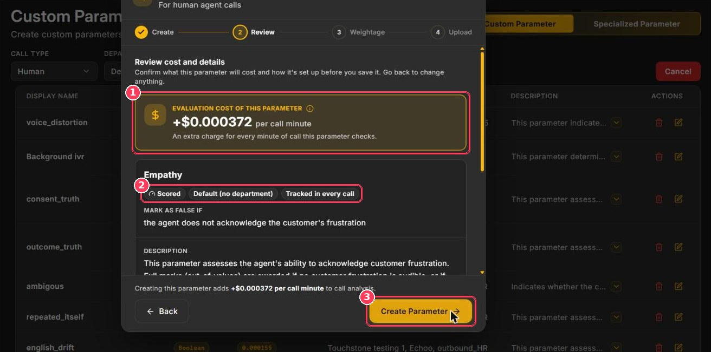

The **Parameter** page defines what Xperia checks on every call and how many points each check is worth.

**To open it:** in the sidebar, under **Configuration**, click **Parameter**.

The page has three tabs:

<CardGroup cols={3}>
  <Card title="Categories Weightage" icon="scale-balanced" href="#categories-weightage">
    Distribute 100 points across categories and parameters.
  </Card>

  <Card title="Custom Parameter" icon="pen-to-square" href="#custom-parameters">
    Create your own checks in plain language.
  </Card>

  <Card title="Specialized Parameter" icon="shield-halved" href="/Pages/specializaParameters">
    Fatal incidents and trackers.
  </Card>
</CardGroup>

<Warning>
  Every **Call Type** (Human or AI) and **Department** combination has its own setup. Always check both selectors before making changes.
</Warning>

## Categories Weightage

<Frame caption="Categories Weightage tab">
  
</Frame>

| # | Element | Description |
| :-: | --- | --- |
| 1 | **Parameter tabs** | Switch between Categories Weightage, Custom Parameter, and Specialized Parameter. |
| 2 | **Call Type · Department** | Choose which scorecard you are editing. |
| 3 | **Total Score · Edit All** | Running total (must be **100/100**) and the button to edit all points. |

### Standard categories

Xperia includes ten categories: **Call Opening**, **Closing**, **Communication**, **Hold Procedure**, **Listening**, **Personalisation**, **Probing**, **Responsibility**, **Tone**, and **Upselling**. Your custom parameters are grouped in their own **Custom Parameter** category.

Each category contains parameters. For example, **Call Opening** contains _Self Introduction_, _Delayed Opening_, and _Assistance Offered_. Click **Category Parameters ▼** to expand a category, and hover the **ⓘ** icon to read a parameter's description.

### Change the weightage

<Steps>
  <Step title="Choose the scorecard">
    Select the **Call Type** and **Department** (callout 2).
  </Step>
  <Step title="Click Edit All">
    Point fields become editable.
  </Step>
  <Step title="Assign points">
    Enter points for each category and its parameters. Set a category to **0** to exclude it from scoring.
  </Step>
  <Step title="Balance to 100">
    Adjust until **Total Score** reads **100/100**.
  </Step>
  <Step title="Save">
    Save your changes. The new weightage applies to calls scored from now on.
  </Step>
</Steps>

<Note>
  Changing weightage does not re-score calls that were already processed.
</Note>

## Custom parameters

Custom parameters let you score behaviors specific to your business — a mandatory greeting, identity verification, a disclosure, upselling — without writing rules by hand. You describe the behavior, and Xperia's AI writes the full evaluation rule.

<Frame caption="Custom Parameter tab">
  
</Frame>

| # | Element | Description |
| :-: | --- | --- |
| 1 | **Add Parameter** | Opens the wizard to create a new parameter. |
| 2 | **Data Type · Parameter Cost** | **Boolean** (true/false) or **float** (a score from zero to full marks), and the extra cost per call minute. |
| 3 | **Actions** | Delete (bin) or edit (pencil) the parameter. |

The **Departments** column shows where each parameter is scored (_Unassigned_ means the Default set), and **Description** shows the full rule — click the arrow to expand it.

### Create a custom parameter

The **Add Custom Parameter** wizard has four steps: **Create → Review → Weightage → Upload**.

<Frame caption="Add Custom Parameter — Create step">
  
</Frame>

| # | Element | Description |
| :-: | --- | --- |
| 1 | **Progress** | The four wizard steps. |
| 2 | **Departments** | Where the parameter will be scored. Use **Select all**, or leave all unselected to add it to the Default set. |
| 3 | **Parameter Name** | A short, clear name such as _Politeness_, _Greeting_, or _Issue Resolution_. |
| 4 | **Mark this as false if…** | The negative behavior that should lose points, for example _the agent does not acknowledge the customer's frustration_. |

Below these fields is **Track this in every call** (on by default). Keep it on only for behaviors that belong in **every** call, such as greeting the customer or reading a compliance statement. With it on, a call that didn't need the behavior can still lose points — for example, with _Empathy_ on, a customer who only asks for an order status is still checked for empathy.

Click **Next** to continue.

<Frame caption="Add Custom Parameter — Review step">
  
</Frame>

| # | Element | Description |
| :-: | --- | --- |
| 1 | **Evaluation cost** | The extra charge per call minute for this parameter (for example _+\$0.000372_). |
| 2 | **Summary tags** | Whether it is scored, its departments, and whether it is tracked in every call. The AI-generated **Description** appears below. |
| 3 | **Create Parameter** | Saves the parameter and moves on. Click **Back** to change anything first. |

Then complete the **Weightage** step — give the new parameter its points while keeping the total at 100 — and finish the wizard.

### Tips for writing good parameters

<AccordionGroup>
  <Accordion title="One behavior per parameter">
    "Agent verified the customer's identity" is easy to score. "Agent was polite, verified identity, and offered help" mixes three checks — split it into three parameters.
  </Accordion>

  <Accordion title="Describe the failure">
    The field is **Mark this as false if…**, so write the negative case: _the agent ends the call without asking if anything else is needed._
  </Accordion>

  <Accordion title="Quote exact wording">
    If agents must say specific words (a greeting, company name, or disclosure), include them in the description.
  </Accordion>

  <Accordion title="Control the cost">
    Every parameter adds a small per-minute cost. Assign parameters only to the departments that need them, and delete ones you no longer use.
  </Accordion>
</AccordionGroup>

### Edit or delete a parameter

- Click the **pencil** to edit the name, rule, or departments.
- Click the **bin** to delete it. Deleted parameters are no longer evaluated; past scores are kept.
