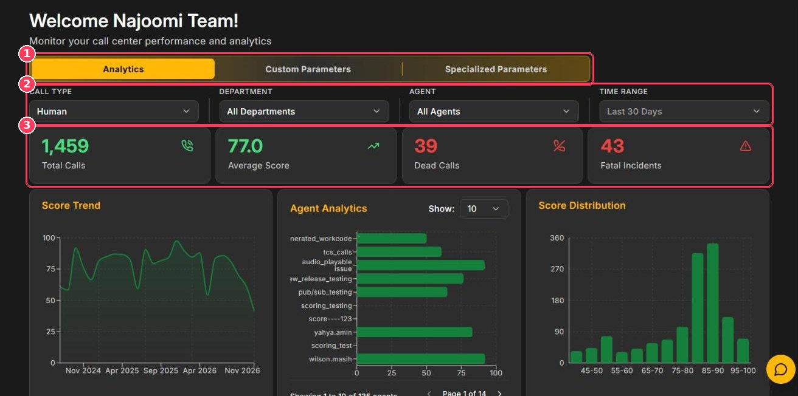
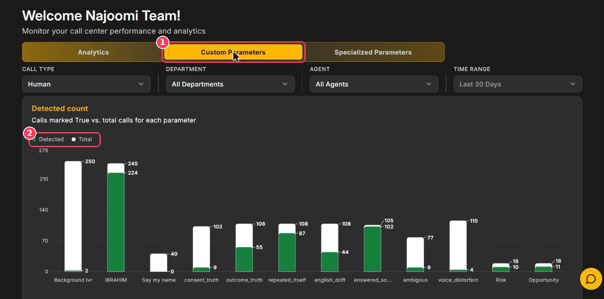
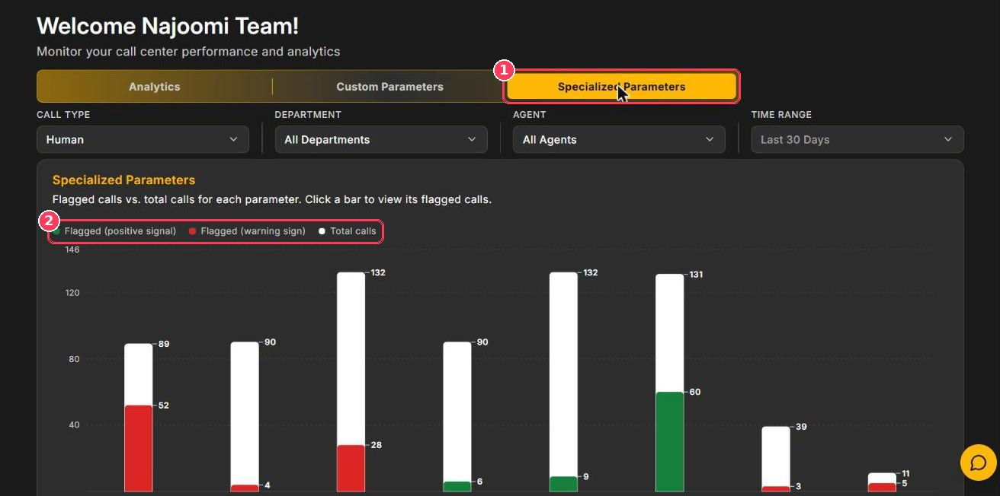

The **Dashboard** is your central view of QA performance. It summarizes every scored call that matches your filters and is organized into three tabs: **Analytics**, **Custom Parameters**, and **Specialized Parameters**.

**To open it:** click **Dashboard** in the sidebar.

## Analytics tab

<Frame caption="Dashboard — Analytics tab">
  
</Frame>

| # | Element | Description |
| :-: | --- | --- |
| 1 | **Dashboard tabs** | Switch between **Analytics**, **Custom Parameters**, and **Specialized Parameters**. |
| 2 | **Filters** | Narrow every chart by **Call Type**, **Department**, **Agent**, and **Time Range**. |
| 3 | **Summary cards** | Headline numbers for the selected period (see below). |

### Filters

| Filter | Options |
| --- | --- |
| **Call Type** | Human, AI Calls |
| **Department** | All Departments, or one department |
| **Agent** | All Agents, or one agent |
| **Time Range** | Today, Yesterday, Last 7 Days, Last 30 Days, Last 90 Days, Last 6 Months, Last Year, Custom Range |

<Tip>
  Select **Custom Range** to choose exact start and end dates — ideal for weekly QA meetings and month-end reviews.
</Tip>

### Summary cards

| Card | Meaning |
| --- | --- |
| **Total Calls** | Number of calls scored in the selected period. |
| **Average Score** | Average call score out of 100. |
| **Dead Calls** | Calls classified as dead — no meaningful conversation took place. |
| **Fatal Incidents** | Calls that triggered a fatal incident condition and were scored zero. |

### Charts

| Chart | What it shows | How to use it |
| --- | --- | --- |
| **Score Trend** | Average score over time. | Spot sustained drops after process, script, or staffing changes. |
| **Agent Analytics** | Average score per agent. Use **Show** to set agents per page and the arrows to page through. | Identify top performers and agents who need coaching. |
| **Score Distribution** | Number of calls in each score band (45–50 … 95–100). | A long tail on the left shows where quality is slipping. |
| **Category Scoring Overview** | The 10 standard categories on a 0–5 scale. Pick a category with the **Category** selector. | See which skill areas are strongest and weakest. |
| **Category Parameters** | **Average Obtained Score** vs. **Average Out Of Score** for each parameter in the selected category. | Find the exact behavior that costs the most points. |

<Note>
  **Reading Category Parameters:** an obtained score of 3.52 against an out-of score of 4.2 means calls earned, on average, 3.52 of 4.2 possible points for that parameter — about 84%.
</Note>

## Custom Parameters tab

<Frame caption="Dashboard — Custom Parameters tab">
  
</Frame>

| # | Element | Description |
| :-: | --- | --- |
| 1 | **Custom Parameters tab** | Results for the custom parameters you created. |
| 2 | **Legend** | **Detected** (green) = calls where the parameter was marked _True_; **Total** (white) = calls it was checked on. |

Below the **Detected count** chart, **Parameters Score** compares the average score per call with the maximum possible score (**Out of**) for each scored parameter. Use the pagination under each chart to see all parameters, and **Add Parameter** to create a new one.

## Specialized Parameters tab

<Frame caption="Dashboard — Specialized Parameters tab">
  
</Frame>

| # | Element | Description |
| :-: | --- | --- |
| 1 | **Specialized Parameters tab** | Results for your trackers. |
| 2 | **Legend** | **Green** = flagged as a positive signal, **Red** = flagged as a warning sign, **White** = total calls checked. |

**To investigate a tracker:** click its bar or select **View calls** under its name. Xperia opens [Call Scoring](/Pages/callScoring) filtered to the flagged calls.

## Recommended weekly review

<Steps>
  <Step title="Set the scope">
    Choose the call type, department, and time range.
  </Step>
  <Step title="Check the headline numbers">
    Compare Average Score, Dead Calls, and Fatal Incidents with the previous period.
  </Step>
  <Step title="Find outliers">
    Use Agent Analytics and Score Distribution to find low-scoring agents and calls.
  </Step>
  <Step title="Find the cause">
    Use Category Parameters and the Custom Parameters tab to see which behaviors lose the most points.
  </Step>
  <Step title="Listen to real calls">
    Open the calls behind the numbers before you coach.
  </Step>
</Steps>
