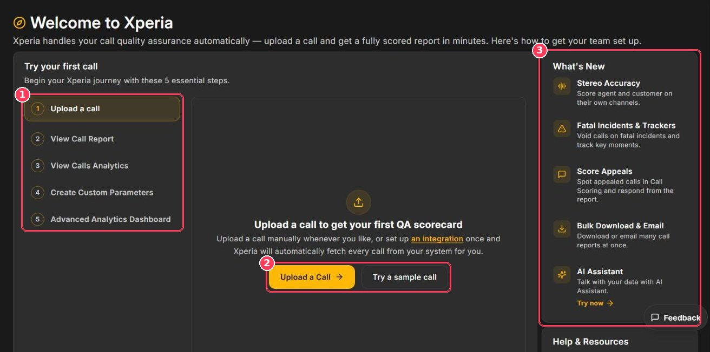

The **Getting Started** page is the first screen you see after signing in. It walks you through five essential steps and links to every settings area.

**To open it:** click **Getting Started** at the top of the sidebar.

<Frame caption="Getting Started page">
  
</Frame>

| # | Element | Description |
| :-: | --- | --- |
| 1 | **Try your first call** | Guided steps. Click a step to see what it does and a button that takes you there. |
| 2 | **Upload a Call · Try a sample call** | Upload your own recording, or score a demo recording instantly. |
| 3 | **What's New** | Recently released features such as Stereo Accuracy, Fatal Incidents & Trackers, Score Appeals, Bulk Download & Email, and the AI Assistant. |

Further down the page, **Help & Resources** offers a **Guided Tutorial** video and **Configure your workspace** shortcuts to Department Management, Retention Period, Work Codes, Billing, Integrator, Report Mailer, Security, Audio Config, and User Management.

## Score your first call

<Steps>
  <Step title="Upload a call">
    Click **Upload a Call** and follow [Upload Calls](/Pages/callUpload) — or click **Try a sample call** to use a demo recording.
  </Step>
  <Step title="View the call report">
    Click **View Call History** to open [Call Scoring](/Pages/callScoring). Open your call to see its score out of 100, summary, reasoning, and coaching suggestions.
  </Step>
  <Step title="View call analytics">
    Click **View Analytics** to open the [Dashboard](/Pages/dashboard) and see scores, trends, and agent performance.
  </Step>
  <Step title="Create a custom parameter">
    Teach Xperia to check something specific to your business. See [Scoring Parameters](/Pages/customParameters).
  </Step>
</Steps>

<Tip>
  Want calls to arrive automatically? Set up the [Integrator](/Pages/integrations) once and Xperia will fetch every call from your system.
</Tip>

## Recommended setup checklist

Complete these once, in order, to get the most accurate results:

| # | Task | Where |
| :-: | --- | --- |
| 1 | Create your departments | [Workspace Settings → Departments](/Pages/workspaceSettings#departments) |
| 2 | Invite your team | [Users & Roles](/Pages/usersAndRoles) |
| 3 | Set stereo accuracy (if your calls are stereo) | [Audio Configuration](/Pages/audioConfig) |
| 4 | Set category weightage per department | [Scoring Parameters](/Pages/customParameters#categories-weightage) |
| 5 | Add custom parameters | [Scoring Parameters](/Pages/customParameters#custom-parameters) |
| 6 | Add fatal incident conditions and trackers | [Specialized Parameters](/Pages/specializaParameters) |
| 7 | Choose work codes | [Workspace Settings → Work Codes](/Pages/workspaceSettings#work-codes) |
| 8 | Set up email reports and fatal alerts | [Reports & Alerts](/Pages/Fatal_Alerts) |
| 9 | Connect your call system | [Integrations](/Pages/integrations) |
