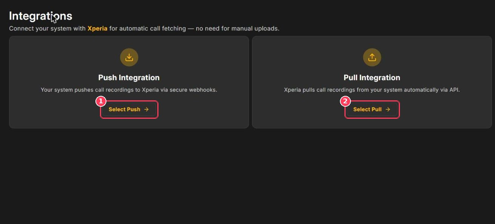
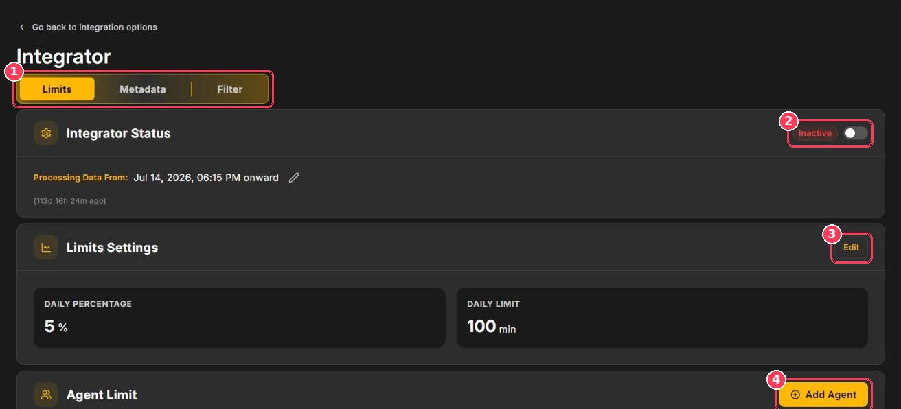
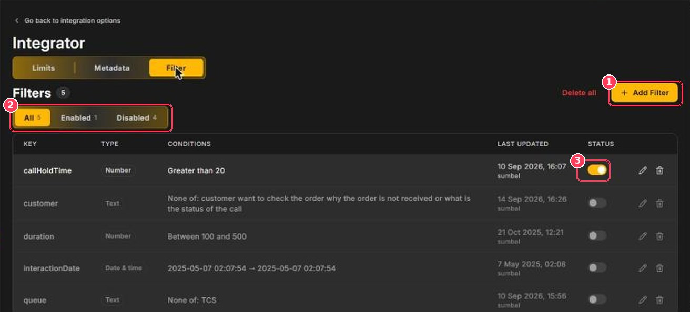

The **Integrator** connects Xperia to your telephony or contact-center platform so calls are imported and scored automatically.

**To open it:** in the sidebar, under **Configuration**, click **Integrator**.

## Choose an integration type

<Frame caption="Integration options">
  
</Frame>

| # | Option | How it works | Best when |
| :-: | --- | --- | --- |
| 1 | **Select Push** | **Your system sends** recordings to Xperia through secure webhooks. | Your platform can call a webhook after each call. |
| 2 | **Select Pull** | **Xperia fetches** recordings from your system through its API. | Your platform exposes recordings and metadata through an API. |

After you select a mode and confirm, Xperia switches your account to it and generates dedicated credentials for your technical team.

<Warning>
  The integration mode applies to your **whole account**. Agree on the mode with your administrator and telephony provider before switching.
</Warning>

Once an integration is configured, the Integrator shows three tabs — **Limits**, **Metadata**, and **Filter**. Use **Go back to integration options** at the top to return to the mode choice.

## Limits

<Frame caption="Integrator — Limits tab">
  
</Frame>

| # | Element | Description |
| :-: | --- | --- |
| 1 | **Limits · Metadata · Filter** | The three Integrator tabs. |
| 2 | **Integrator Status** | Turn on (**Active**) to import calls, or off (**Inactive**) to pause. **Processing Data From** shows the start date — click the pencil to change it. |
| 3 | **Edit** | Change the daily limits. |
| 4 | **Add Agent** | Set a higher share of calls for specific agents. |

| Setting | Meaning |
| --- | --- |
| **Daily Percentage** | Share of each day's calls to score, for example 5%. |
| **Daily Limit** | Maximum call minutes to score per day, for example 100 min. |
| **Agent Limit → Extra Call %** | Additional share of calls to score for a specific agent — useful for new hires or agents on a performance plan. |

## Metadata

The **Metadata** tab lists the fields your system sends with each call — for example _InteractionDate_, _Agents_, _Queue_, _Direction_, _Duration_, _Disposition_, and _CallHoldTime_. Switch between **Formatted** and **JSON** views.

Check this tab to confirm exact field names and values before creating filters.

## Filter

Filters decide **which** calls are imported. A call must match every enabled filter to be scored.

<Frame caption="Integrator — Filter tab">
  
</Frame>

| # | Element | Description |
| :-: | --- | --- |
| 1 | **Add Filter** | Create a new filter. |
| 2 | **All · Enabled · Disabled** | View filters by status. |
| 3 | **Status toggle** | Switch a filter on or off. Use the pencil or bin to edit or delete it. |

Each filter has a **Key** (metadata field), a **Type** (Number, Text, or Date & time), and a **Condition**:

| Key | Type | Condition | Effect |
| --- | --- | --- | --- |
| callHoldTime | Number | Greater than 20 | Only calls with more than 20 seconds on hold |
| duration | Number | Between 100 and 500 | Skip very short and very long calls |
| queue | Text | None of: _a queue name_ | Exclude a specific queue |

### Add a filter

<Steps>
  <Step title="Click Add Filter">
    The **Add New Filter** form opens.
  </Step>
  <Step title="Select the key">
    Choose a metadata field from **Select Key**.
  </Step>
  <Step title="Set the condition">
    Choose the operator and enter the value(s).
  </Step>
  <Step title="Save">
    Leave **Filter Status** set to **Enabled** and save.
  </Step>
</Steps>

<Warning>
  Filter values must match your metadata **exactly**, including spelling and capitalization.
</Warning>

**Delete all** removes every filter at once.
