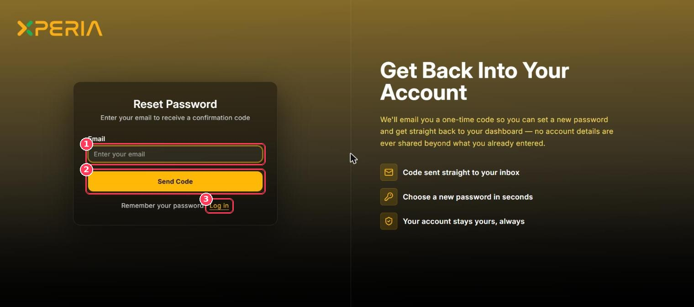

You can reach Xperia at [xperia.najoomi.ai](https://xperia.najoomi.ai). Click **Login** in the top-right corner of the website to open the sign-in page.

## Log in

<Frame caption="Log in page">
  
</Frame>

| # | Element | Description |
| :-: | --- | --- |
| 1 | **Email** | The email address (or username) of your Xperia account. A **LAST USED** tag appears when your browser remembers the account. |
| 2 | **Password** | Your password. Click the eye icon to show or hide it. |
| 3 | **Log In** | Signs you in and opens the portal. |
| 4 | **Continue with Google** | Signs in with your Google account instead of a password. |
| 5 | **Sign up · Forgot Password?** | Create a new workspace account, or reset a forgotten password. |

<Steps>
  <Step title="Open the login page">
    Go to [xperia.najoomi.ai](https://xperia.najoomi.ai) and click **Login**.
  </Step>
  <Step title="Enter your credentials">
    Type your email and password — or click **Continue with Google**.
  </Step>
  <Step title="Click Log In">
    You land on the Xperia portal. New users start on [Getting Started](/Pages/gettingStarted).
  </Step>
</Steps>

<Note>
  If your workspace has **Two-Factor Authentication** turned on (see [Workspace Settings → Security](/Pages/workspaceSettings#security)), you'll be asked to verify your identity after entering your password.
</Note>

## Reset your password

<Frame caption="Reset Password page">
  
</Frame>

| # | Element | Description |
| :-: | --- | --- |
| 1 | **Email** | The email address of your account. |
| 2 | **Send Code** | Emails you a one-time confirmation code. |
| 3 | **Log in** | Returns to the login page. |

<Steps>
  <Step title="Click Forgot Password?">
    On the login page, below the sign-in buttons.
  </Step>
  <Step title="Enter your email and click Send Code">
    Xperia emails you a one-time code.
  </Step>
  <Step title="Enter the code and choose a new password">
    Check your inbox (and spam folder), enter the code, and set your new password.
  </Step>
  <Step title="Log in">
    Sign in with your new password.
  </Step>
</Steps>

## Create a workspace account

New organizations can create their own Xperia workspace.

<Frame caption="Create your workspace account">
  
</Frame>

| # | Element | Description |
| :-: | --- | --- |
| 1 | **Full Name · Email · Password · Confirm Password** | Your details and a password for the new account. |
| 2 | **Create Account** | Creates the workspace. You can also choose **Continue with Google**. |

By signing up you agree to Xperia's Terms of Service and Privacy Policy. Already have an account? Click **Sign in to your dashboard**.

<Tip>
  Joining an existing team? You don't need to sign up — ask your workspace Admin to invite you from [Users & Roles](/Pages/usersAndRoles). You'll receive an email invitation.
</Tip>

## Sign out

Click **Logout** at the bottom of the sidebar. For security, always sign out on shared computers.
