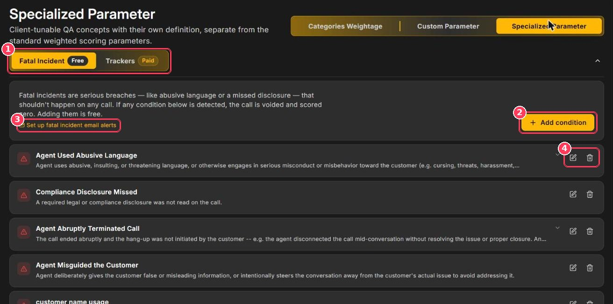
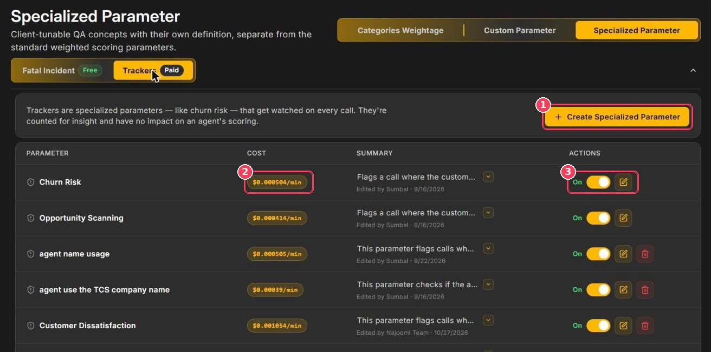
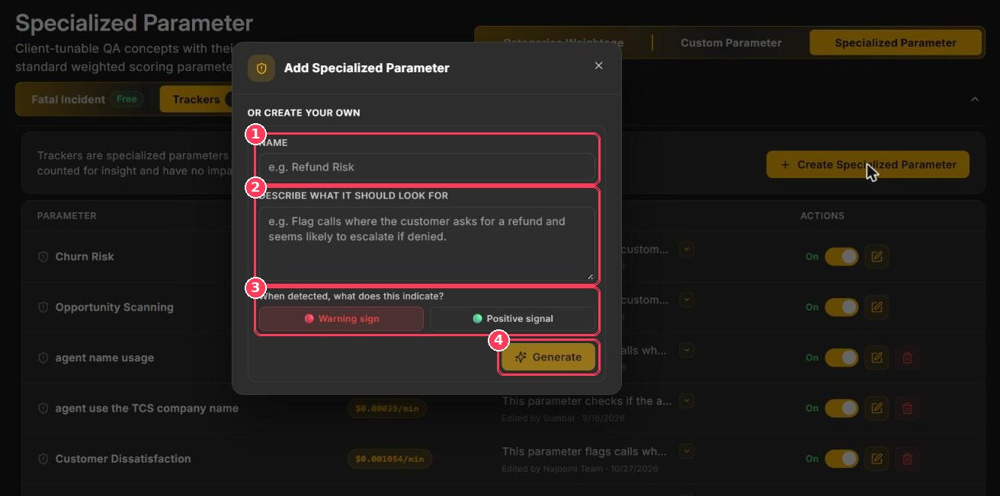

Specialized parameters are QA concepts with their own definitions, separate from the weighted scorecard.

**To open them:** go to **Parameter** → **Specialized Parameter**.

There are two kinds:

|  | **Fatal Incident** | **Trackers** |
| --- | --- | --- |
| **Purpose** | Catch serious breaches that should never happen | Watch for business signals — risks or opportunities |
| **Effect on score** | Call is voided and scored **zero** | **None** — counted for insight only |
| **Cost** | Free | Paid, per call minute |
| **Examples** | Abusive language, missed disclosure, agent hung up on the customer | Churn risk, upsell opportunity, customer dissatisfaction |

## Fatal incidents

<Frame caption="Fatal Incident tab">
  
</Frame>

| # | Element | Description |
| :-: | --- | --- |
| 1 | **Fatal Incident · Trackers** | Switch between the two kinds of specialized parameters. |
| 2 | **Add condition** | Create a new fatal incident condition. |
| 3 | **Set up fatal incident email alerts** | Shortcut to [Reports & Alerts](/Pages/Fatal_Alerts). |
| 4 | **Edit · Delete** | Change or remove a condition. |

If **any** condition is detected on a call, Xperia voids the call and scores it zero. In Call Scoring the score shows **Fatal Incident** in red, and the Dashboard counts it under **Fatal Incidents**.

### Example conditions

| Condition | Triggers when… |
| --- | --- |
| **Agent Used Abusive Language** | The agent uses insulting, threatening, or abusive language. |
| **Compliance Disclosure Missed** | A required legal or compliance disclosure is not read. |
| **Agent Abruptly Terminated Call** | The agent disconnects mid-conversation without resolving the issue. |
| **Agent Misguided the Customer** | The agent deliberately gives false or misleading information. |

### Add a condition

<Steps>

<Step title="Click Add condition">

A form opens above the list.

</Step>

<Step title="Name the condition">

For example, _Agent Used Abusive Language_.

</Step>

<Step title="Describe what should trigger it">

Be specific: _Agent uses abusive, insulting, or inappropriate language._

</Step>

<Step title="Save">

Click **Add condition**. It applies to calls scored from now on.

</Step>

</Steps>

<Warning>
  Keep conditions narrow and specific. A broad condition such as "agent sounded rude" can void many legitimate calls. If a call is flagged by mistake, a reviewer can turn off the **Fatal Incident** toggle in the report's edit mode.
</Warning>

## Trackers

<Frame caption="Trackers tab">
  
</Frame>

| # | Element | Description |
| :-: | --- | --- |
| 1 | **Create Specialized Parameter** | Create a new tracker. |
| 2 | **Cost** | Extra charge per call minute while the tracker is on. |
| 3 | **On/Off · Edit** | Pause or resume the tracker, or edit its definition. |

The **Summary** column shows what each tracker looks for and who last edited it.

### Create a tracker

<Frame caption="Add Specialized Parameter dialog">
  
</Frame>

| # | Field | Description |
| :-: | --- | --- |
| 1 | **Name** | For example, _Refund Risk_. |
| 2 | **Describe what it should look for** | For example, _Flag calls where the customer asks for a refund and seems likely to escalate if denied._ |
| 3 | **Warning sign · Positive signal** | Whether a match is bad news (red) or good news (green). |
| 4 | **Generate** | Xperia writes the full definition for you to review and save. |

### Where tracker results appear

- **Call reports** — matched trackers appear as tags under _Call Details_.
- **Dashboard → Specialized Parameters** — flagged vs. total calls; click a bar or **View calls** to see them.
- **Call Scoring → Filters** — filter by **Specialized Parameter**.
- **Bulk Download** — export only calls flagged by a tracker.

<Tip>
  Switch a tracker **Off** to stop paying for it without losing its definition.
</Tip>
