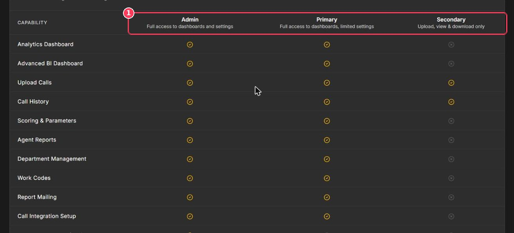

**User Management** is where admins invite teammates, assign roles, and remove access.

**To open it:** in the sidebar, under **Configuration**, click **Users**.

## Roles

Xperia has three roles:

<CardGroup cols={3}>
  <Card title="Admin" icon="user-shield">
    Full access to dashboards and **all** settings, including users, billing, retention, and security.
  </Card>

  <Card title="Primary" icon="user-tie">
    Full access to dashboards and QA work, with limited settings.
  </Card>

  <Card title="Secondary" icon="user">
    Upload, view, and download only.
  </Card>
</CardGroup>

<Frame caption="Role guide at the bottom of User Management">
  
</Frame>

| # | Element | Description |
| :-: | --- | --- |
| 1 | **Role columns** | Admin, Primary, and Secondary, with a summary of each role's access. |

### Permission matrix

| Capability | Admin | Primary | Secondary |
| --- | :-: | :-: | :-: |
| Analytics Dashboard | ✅ | ✅ | — |
| Upload Calls | ✅ | ✅ | ✅ |
| Call History | ✅ | ✅ | ✅ |
| Scoring & Parameters | ✅ | ✅ | — |
| Agent Reports | ✅ | ✅ | — |
| Department Management | ✅ | ✅ | — |
| Work Codes | ✅ | ✅ | — |
| Report Mailing | ✅ | ✅ | — |
| Call Integration Setup | ✅ | ✅ | — |
| User Management / Invites | ✅ | — | — |
| Billing | ✅ | — | — |
| Data Retention Settings | ✅ | — | — |
| Security Settings | ✅ | — | — |

## Invite a user

<Steps>
  <Step title="Click Add User">
    At the top right of User Management. The **Add New User** dialog opens.
  </Step>
  <Step title="Enter the email address">
    The invitation is sent to this address.
  </Step>
  <Step title="Enter the full name">
    Type a name or pick an existing agent. This is how the user is shown, and they can't change it themselves.
  </Step>
  <Step title="Select a role">
    Admin, Primary, or Secondary.
  </Step>
  <Step title="Choose a department (optional)">
    Assign the user to a department.
  </Step>
  <Step title="Click Add User">
    The user receives an email invitation.
  </Step>
</Steps>

## Manage users

- The cards at the top show **Total Users** and the number of **Admins**, **Primary**, and **Secondary** users.
- Search the **User Directory** by name or email.
- Each user shows their **Role** and **Status** (for example _active_).
- Click the **bin** to remove a user's access, or the **refresh** button to reload the list.

<Tip>
  Follow the principle of least privilege: QA analysts usually need **Primary**; team members who only upload calls need **Secondary**.
</Tip>
