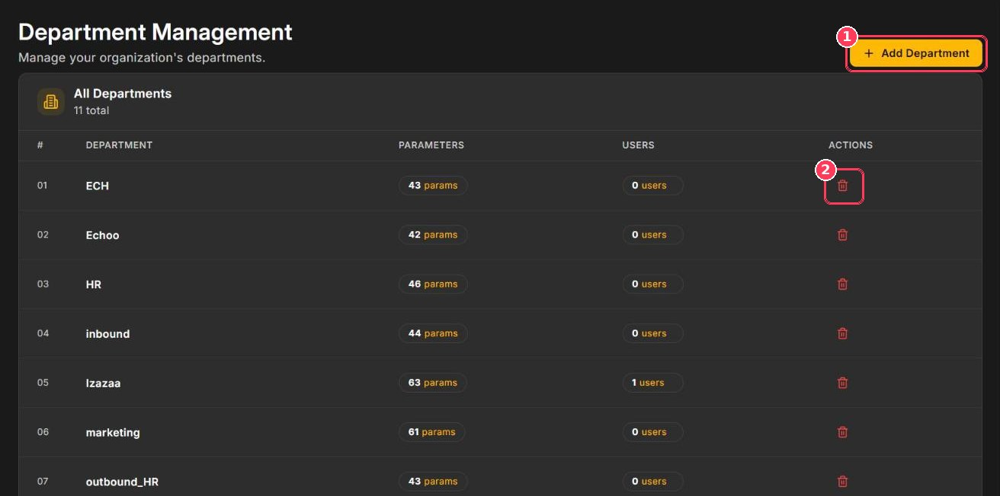
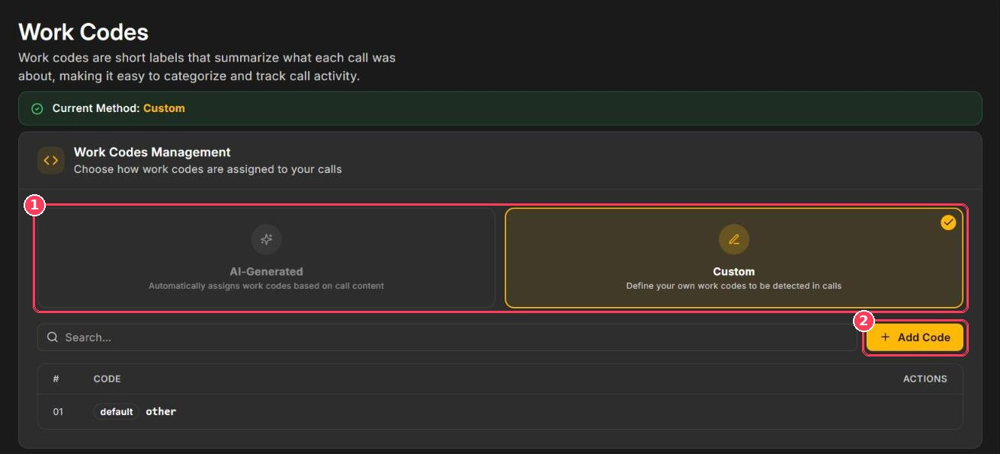
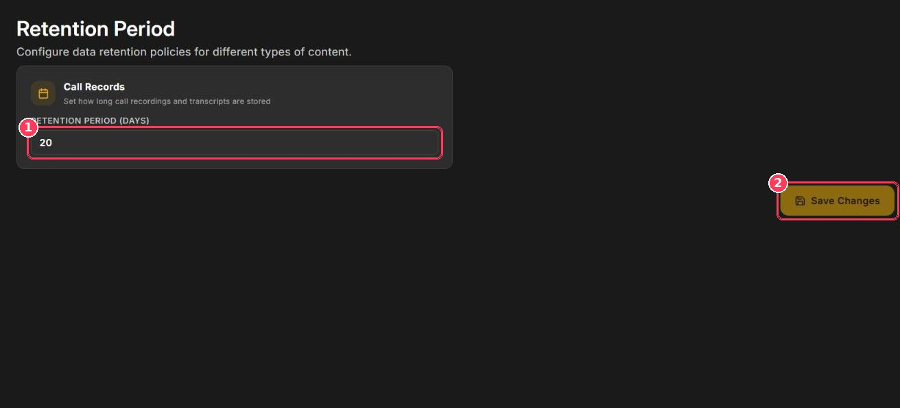
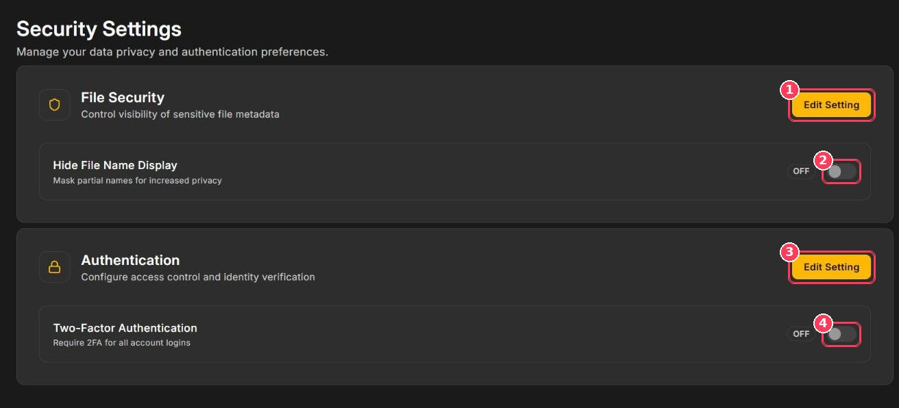

This page covers four configuration areas in the sidebar: **Departments**, **Work Codes**, **Retention**, and **Security**.

## Departments

Departments group your agents and calls — for example _Inbound_, _Outbound_, _Sales_, or _Support_. Each department can have its own parameters and category weightage, so every team is scored on what matters for its work.

**To open it:** in the sidebar, under **Configuration**, click **Departments**.

<Frame caption="Department Management">
  
</Frame>

| # | Element | Description |
| :-: | --- | --- |
| 1 | **Add Department** | Opens a dialog. Enter a **Department Name** and click **Add Department**. |
| 2 | **Delete** | Removes the department. |

The table lists every department with the number of **parameters** and **users** assigned to it.

<Tip>
  After creating a department, configure its scorecard on the [Parameter](/Pages/customParameters) page by selecting it in the **Department** selector. You can also assign users to it when inviting them in [Users & Roles](/Pages/usersAndRoles).
</Tip>

## Work codes

Work codes are short labels that summarize what each call was about, such as _order delivery issue_. They appear on every call report and help you categorize and track call reasons.

**To open it:** in the sidebar, under **Configuration**, click **Work Codes**.

<Frame caption="Work Codes Management">
  
</Frame>

| # | Element | Description |
| :-: | --- | --- |
| 1 | **Assignment method** | **AI-Generated** — Xperia writes a work code for each call automatically. **Custom** — you define the list and Xperia picks the best match. The active method is shown at the top as **Current Method**. |
| 2 | **Add Code** | Adds a custom work code (Custom method only). |

Calls that match none of your custom codes receive the default code **other**. Use the search box to find codes in long lists.

<Note>
  Reviewers can correct a call's work code in the report's edit mode. See [Call Scoring & Call Reports](/Pages/callScoring#edit-a-score).
</Note>

## Retention

Retention controls how many days call recordings and transcripts are stored.

**To open it:** in the sidebar, under **Configuration**, click **Retention**.

<Frame caption="Retention Period">
  
</Frame>

| # | Element | Description |
| :-: | --- | --- |
| 1 | **Retention Period (Days)** | Number of days to keep call records. |
| 2 | **Save Changes** | Applies the new period. |

<Warning>
  Records older than the retention period are removed. Confirm the period meets your compliance and audit requirements before shortening it.
</Warning>

## Security

Security Settings protect sensitive data and access to your workspace.

**To open it:** in the sidebar, under **Configuration**, click **Security**.

<Frame caption="Security Settings">
  
</Frame>

| # | Element | Description |
| :-: | --- | --- |
| 1 | **Edit Setting** (File Security) | Unlocks the file security options. |
| 2 | **Hide File Name Display** | Masks part of each recording's file name — useful when file names contain phone numbers, emails, or customer IDs. |
| 3 | **Edit Setting** (Authentication) | Unlocks the authentication options. |
| 4 | **Two-Factor Authentication** | Requires 2FA for all account logins. |

<Tip>
  We recommend enabling **Two-Factor Authentication** for every workspace.
</Tip>
